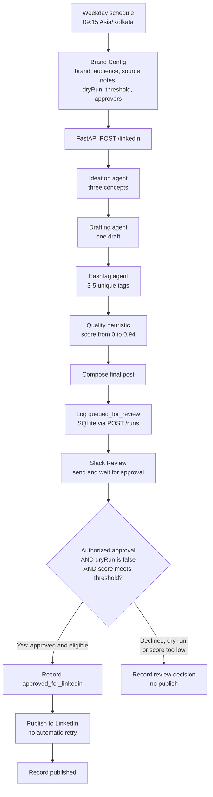
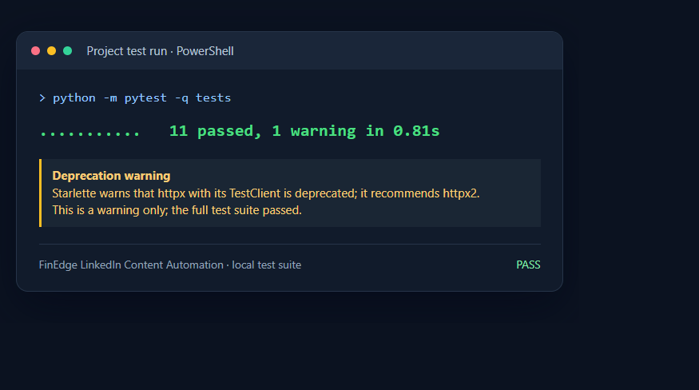

# FinEdge LinkedIn Content Automation

An AutoGen-inspired FastAPI service generates three content ideas, a LinkedIn draft, a heuristic quality score, and hashtags. An n8n workflow schedules the run, composes the final text, records an audit trail in SQLite, and requires an authorized Slack approval before any eligible LinkedIn publishing.

## End-to-end flow



### What happens in each stage

1. **Schedule and configuration.** The workflow runs weekdays at 09:15 in `Asia/Kolkata`. **Brand Config** supplies the brand voice, audience, key points, prohibited claims, call to action, organization URN, review threshold, Slack approver IDs, and a `runId` based on the n8n execution ID. `dryRun` is `true` by default.
2. **Content generation.** n8n calls `POST /linkedin`. The FastAPI service sends the brand and context through three sequential, narrowly scoped model requests: generate exactly three ideas, draft the post, and propose 3–5 unique hashtags. These are separate prompts implemented in this service; the project does not depend on the AutoGen library.
3. **Quality score.** A transparent heuristic checks draft length, topic/CTA presence, key-point coverage, and prohibited phrases. It is a routing signal, not a probability or a fact-check. The score is capped at `0.94`.
4. **Compose and audit.** n8n joins the draft and hashtags, then creates a `queued_for_review` SQLite run record before asking a reviewer. The service also persists successful generation and records generation failures.
5. **Human decision.** Slack's native **Send and Wait for Response** operation pauses the workflow for an Approve or Decline decision. The app's configured signing secret lets n8n validate Slack callbacks, and configured user IDs restrict who can decide.
6. **Fail-closed publish guard.** LinkedIn publishing is reachable only when the Slack response says `approved`, `dryRun` is `false`, and `confidenceScore >= minConfidence`. A decline, dry run, or low score is recorded as a review outcome and does not publish.
7. **Delivery record.** The workflow records `approved_for_linkedin` before posting, then `published` after a successful LinkedIn response. The LinkedIn POST is not retried automatically: if a request times out after LinkedIn accepted it, retrying could create a duplicate.

The flow diagram is also available as [the n8n workflow JSON](workflows/linkedin_content_automation.json). Import it inactive and configure all credentials and placeholders before running.

### Publish decision table

| Slack decision | `dryRun` | Score | Outcome |
|---|---:|---:|---|
| Decline | Any | Any | Record `rejected`; do not publish |
| Approve | `true` | Any | Record `approved_dry_run`; do not publish |
| Approve | `false` | Below `minConfidence` | Record `approved_below_threshold`; do not publish |
| Approve | `false` | At or above `minConfidence` | Record `approved_for_linkedin`, attempt LinkedIn publish, then record `published` on success |

This is a routing gate, not a content correctness guarantee. A reviewer should check claims and source material even when the score is high.

### Service endpoints

| Method and path | Purpose | Authentication |
|---|---|---|
| `GET /healthz` | Liveness check | Public |
| `POST /linkedin` | Generate ideas, draft, score, tags, and trace; also persist a `generated` run | `X-API-Key` when `API_KEY` is configured |
| `POST /runs` | Upsert a workflow status, route, final text, score, and dry-run flag | `X-API-Key` when configured |
| `GET /runs/{run_id}` | Retrieve a run and its latest state | `X-API-Key` when configured |

API request and response models enforce field lengths and score bounds. SQLite uses `runId` as the upsert key; set `AUTOMATION_DB_PATH` to a persistent mounted location in deployment.

`AI_MODE=auto` is the default: it uses the OpenAI-compatible provider when `OPENAI_API_KEY` is set, and otherwise sends the three agent requests to local Ollama without an API key. `AI_MODE=ollama` forces Ollama, `AI_MODE=openai` forces the keyed provider, and `AI_MODE=demo` selects deterministic offline output for tests. The returned confidence is a transparent content-quality heuristic, not a probability that claims are true. Human review remains essential for regulated financial content.

## Local setup

Python 3.10 or newer is required.

> **Dependency note:** The dependency entries in `requirements.txt` and `requirements-dev.txt` have been cleared. Restore the required packages before installing or running the application; installing from the currently empty files will not install FastAPI or the other runtime dependencies.

```powershell
python -m venv .venv
.\.venv\Scripts\Activate.ps1
python -m pip install -r requirements.txt
Copy-Item .env.example .env
uvicorn main:app --reload --env-file .env
```

On Ubuntu, use `python3 -m venv .venv`, `source .venv/bin/activate`, and `cp .env.example .env`. The service listens on port 8000. Check `http://127.0.0.1:8000/healthz` and interactive API docs at `http://127.0.0.1:8000/docs`.

### API smoke test

```bash
curl -X POST http://127.0.0.1:8000/linkedin \
  -H 'Content-Type: application/json' \
  -d '{
    "runId":"smoke-test-001",
    "brand":{"name":"FinEdge Mumbai","audience":"Indian finance professionals","tone":"clear and credible","key_principles":["financial inclusion"],"prohibited_claims":["guaranteed returns"]},
    "context":{"topic":"responsible digital finance","key_points":["financial literacy","informed decisions"],"call_to_action":"What would you add to the conversation?","source_notes":"Use only these supplied points."}
  }'
```

Expect HTTP 200 with `ideas` (three strings), `draft`, `confidenceScore` (0 to 1), `hashtags`, and `trace`. Each generated run is persisted automatically. Inspect it at `GET /runs/smoke-test-001`; `POST /runs` upserts the route and delivery status from n8n.

With the default `AI_MODE=auto`, no API key is needed for model calls when Ollama is installed and running. Pull the configured model once with `ollama pull qwen:latest`; set `OLLAMA_MODEL` to a different locally available model if needed. Ollama listens on port 11434 by default. `OLLAMA_TIMEOUT_SECONDS` defaults to 180 because local model startup can be slower than hosted APIs. If Ollama is not reachable or the model is missing and no OpenAI key is configured, `/linkedin` returns an actionable error and records the failed run rather than silently switching to demo text.

Ollama troubleshooting: check installed models with `ollama list` and pull the configured model if the service reports it missing. A 504 indicates the local model exceeded `OLLAMA_TIMEOUT_SECONDS`; increase it, use a smaller model, or lower `OLLAMA_NUM_PREDICT`. The service disables Qwen thinking tokens and strips JSON Markdown fences before parsing agent output.

To use an OpenAI-compatible provider, set `OPENAI_API_KEY` in `.env`; auto mode then prefers it. `OPENAI_BASE_URL` and `OPENAI_MODEL` support compatible providers. For Docker, `127.0.0.1` points inside the service container, so set `OLLAMA_BASE_URL` to a reachable host address such as `http://host.docker.internal:11434` (or the Ollama service name on a shared Docker network). Ollama requests stay on the configured Ollama host; keyed provider calls send brand and source-note data to that provider. Review your organization's data-handling requirements before enabling remote calls.

Set a strong `API_KEY` before exposing the service. Authenticated endpoints require `X-API-Key`; `/healthz` remains public. In n8n, create an **HTTP Header Auth** credential with header `X-API-Key` and the same value, then attach it to the microservice and run-log HTTP nodes.

## n8n setup

1. Import `workflows/linkedin_content_automation.json` in n8n. Keep it inactive while configuring credentials.
2. Open **Brand Config** and replace the sample topic, audience, points, call to action, prohibited claims, confidence threshold, Slack approver user IDs, and organization URN. `dryRun` is `true` by default.
3. Update the service URLs (`/linkedin` and each `/runs` node) to an address reachable from n8n. `host.docker.internal` is convenient on Docker Desktop; on a Linux VM, use the service/container DNS name or configure the Docker host gateway. If n8n runs directly on the VM, use `http://127.0.0.1:8000`.
4. Attach the HTTP Header Auth credential to each service HTTP node.
5. Configure **Slack Review** with a Slack API credential, the review channel ID, and real Slack user IDs in `approverUserIds`. The placeholder ID is intentionally not an approver. In the Slack app, enable **Interactivity & Shortcuts**, set its Request URL to `https://<your-n8n-instance>/webhook-waiting-slack`, and add the app's Signing Secret to the n8n Slack credential. n8n validates Slack's signed approval callbacks. Keep the review channel private because its members can see draft content.
6. For live posting only, configure the LinkedIn OAuth2 credential with the required organization-posting access, replace the LinkedIn version placeholder with a version currently supported by LinkedIn, and set a real organization URN. Keep `dryRun=true` until the full approval flow is verified.
7. Execute nodes in order through **Slack Review**, approve or decline the message as a configured approver, and confirm the resulting branch and `GET /runs/<runId>` record. Then run the whole workflow manually and test both decisions.
8. Set `dryRun=false` only when ready. Approval is always required; approval alone cannot bypass dry-run or the `minConfidence` threshold. Activate the schedule after a supervised full run.

The schedule is weekdays at 09:15 in `Asia/Kolkata`; edit the Schedule Trigger if the organization's cadence differs. n8n execution history is enabled for success and error data. Service and run-log nodes retry transient failures; the Slack approval node waits for a decision. The LinkedIn publish node deliberately does not retry because a timeout can occur after LinkedIn accepted a post. If publishing fails or times out, check LinkedIn and the n8n execution before manually retrying to avoid duplicate posts.

### LinkedIn OAuth notes

The live node targets `POST https://api.linkedin.com/rest/posts` and uses the current organization URN and API-version header. LinkedIn access is subject to app approval, product access, scopes, and organization role permissions. LinkedIn changes version requirements; use a currently supported `YYYYMM` value when configuring the node. Do not test against a real organization until the dry-run route and permissions have been independently reviewed.

## VM deployment

The service can run under a process manager or Docker. For Docker, build with `docker build -t finedge-linkedin-service .` and run with a persistent volume mounted at `/app/data`; pass environment variables through your secret manager. Configure `OLLAMA_BASE_URL` to a container-reachable Ollama host when using local inference. Do not publish port 8000 directly to the public internet. Put it behind a TLS reverse proxy and require `API_KEY`. n8n must be able to reach the private service address.

For a direct Ubuntu process, install requirements in a virtual environment and run `uvicorn main:app --host 0.0.0.0 --port 8000 --env-file .env` under systemd or another supervisor. Restrict network access to the n8n host and preserve the configured SQLite directory across restarts.

## Logging and safety

- SQLite stores run ID, timestamps, status, composed text, confidence, dry-run flag, route, and error text. Updates use the run ID as an upsert key.
- Standard application logs include run IDs and the selected mode; API secrets and request bodies are not logged.
- n8n stores execution input/output and failure history. Protect n8n access and set an appropriate retention policy because execution data contains draft content.
- The score checks length, topic/CTA presence, key-point coverage, and prohibited phrases. It does not verify factual accuracy, legal compliance, or suitability for publication.
- Every draft waits for a Slack approval. The workflow publishes only when an authorized approver approves, dry run is disabled, and the heuristic score meets the configured threshold. Approval and rejection decisions are recorded; a dry run or below-threshold score cannot publish.
- The LinkedIn request is not retried automatically to reduce duplicate-post risk. A manual retry should happen only after checking whether LinkedIn accepted the first request.

## Tests and evidence

Run the local service and workflow artifact tests with:

```bash
python -m pip install -r requirements-dev.txt
python -m pytest -q
```

The tests cover the structured response, SQLite persistence/upsert, API-key enforcement, validation errors, generation failure persistence, heuristic scoring for prohibited claims, JSON parsing, hashtag filtering, Ollama request construction, and guarded workflow approval routing. The latest local run completed with **11 passing tests** and one Starlette/httpx deprecation warning. The image below is a rendered screenshot summary of that test output; it is not evidence of a live n8n, Slack, or LinkedIn run.



The [API smoke-test screenshot](screenshots/api-success.png) records a previous Swagger UI request to `POST /linkedin` and its successful response. A separate previous local test used Ollama `qwen:latest`. These are local service checks only: this workspace has no configured VM, n8n instance, Slack credential, or LinkedIn credential, so no end-to-end external delivery is claimed.

## Reflection

The three prompt roles keep each generation step narrow and the pipeline inspectable without requiring an orchestration library. Auto mode supports local Ollama while preferring a configured hosted provider; demo mode keeps tests deterministic. Local inference trades provider data transfer and usage cost for host compute, model management, and latency. The quality heuristic is explicitly non-probabilistic. Slack approval, the dry-run default, a confidence threshold, an audit trail, an inactive imported workflow, and the absence of automatic LinkedIn retries provide operational guardrails, but they do not replace review of factual claims or monitoring of delivery outcomes.